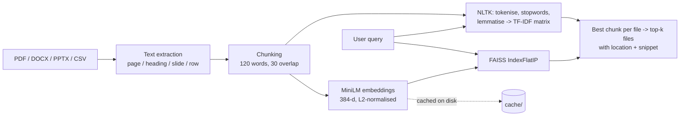
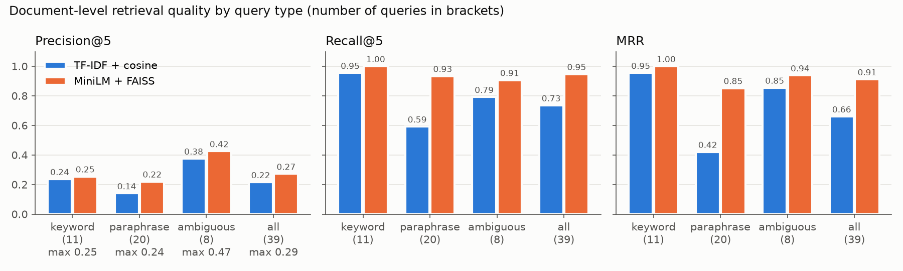
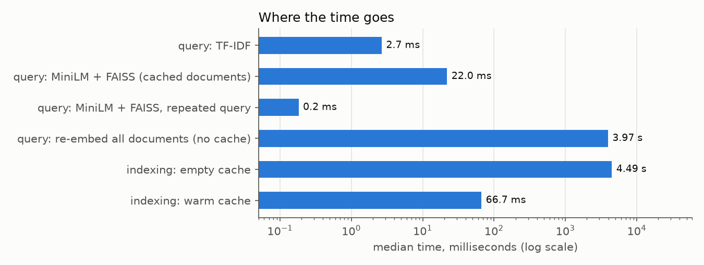

# Neural File Search

Search across PDF, Word, PowerPoint and CSV files by **meaning**, not only by exact words.
The main model is `sentence-transformers/all-MiniLM-L6-v2` with a FAISS vector index. It is
compared with a TF-IDF keyword baseline on a labelled query set.

```text
query: "can I do my job from my house some days"

TF-IDF (keyword)                          MiniLM + FAISS (semantic)
1. new_hire_onboarding_checklist.docx     1. remote_work_guidelines.pdf  (page 1)   <- correct
2. service_catalog.csv                    2. employee_leave_policy.pdf   (page 1)
3. employee_leave_policy.pdf              3. new_hire_onboarding_checklist.docx
```
*(Real output of `python search.py ... --top-k 3`. The relevant policy says "work remotely ...
up to three days per week". The only content word it shares with the query is "days".)*

## Problem and use case

Company knowledge is spread across policies (PDF), procedures (DOCX), slide decks (PPTX) and
spreadsheets (CSV). Keyword search only works when the user guesses the author's wording.
Someone who asks *"how much time off do new dads get?"* will not find a policy that says
*"partners receive four weeks of paternity leave"*. Semantic search compares the *meaning* of
the query with the meaning of each passage, then points the user to the exact file and page,
slide or row.

## Architecture



| Step | Implementation | File |
|---|---|---|
| Extraction | `pypdf` (per page), `python-docx` (per heading section + tables), `python-pptx` (per slide incl. tables and notes), `pandas` (per row as `column: value; ...`) | `documents.py` |
| Chunking | word windows of 120 words with 30-word overlap, never crossing a page/slide/row, so every chunk keeps an exact location | `documents.py` |
| Model A: TF-IDF | NLTK `word_tokenize`, stopword removal, WordNet lemmatisation → `TfidfVectorizer(sublinear_tf=True)` → cosine | `search.py` |
| Model B: MiniLM + FAISS | `all-MiniLM-L6-v2` on the original text → unit vectors → `faiss.IndexFlatIP` (exact inner product = cosine) | `search.py` |
| Ranking | each file is scored by its best chunk, so one file cannot fill several top-5 slots | `search.py` |
| Caching | on disk: per-file chunks (no model involved), per-file embeddings keyed by the model's weights, and the FAISS index; query embeddings in an in-memory LRU | `search.py` |

**Why NLTK only for TF-IDF?** Stopword removal and lemmatisation help keyword matching, but they
remove meaning ("*not* eligible", "*before* noon"). MiniLM is trained on natural sentences, so it
receives the text with whitespace cleaned up only.

**Role of FAISS.** FAISS stores the vectors and returns the most similar ones. With 155 chunks the
project uses `IndexFlatIP`, an *exact* search. The same code could later use an approximate index
(IVF, HNSW) for millions of chunks. The results below show that at this size FAISS is not faster
than plain NumPy (see Latency).

## Supported formats and error handling

`.pdf`, `.docx`, `.pptx`, `.csv` (UTF-8 or Latin-1). The following are reported as warnings
and the remaining files are still indexed: empty files, corrupted files, scanned PDFs without a
text layer ("needs OCR"), header-only CSVs and unsupported extensions.

## Installation

Tested on Windows 11, Python 3.12.10, CPU only.

```bash
python -m venv .venv
.venv\Scripts\activate                     # macOS/Linux: source .venv/bin/activate
pip install torch --index-url https://download.pytorch.org/whl/cpu   # optional: smaller CPU-only PyTorch
pip install -r requirements.txt
```

The first run downloads the MiniLM weights (~90 MB) into the Hugging Face cache, outside this
repository. Later runs load them from disk without contacting the Hub.

## Usage

```bash
python prepare_data.py                     # (re)create the 32 sample documents, queries and labels
python search.py "how do I claim a hotel on a work trip" --mode minilm --top-k 5
python search.py "per diem" --mode tfidf    # keyword baseline only: MiniLM/PyTorch are not loaded
streamlit run app.py                       # web app at http://localhost:8501
python evaluate.py                         # benchmark, writes results/ (~3-4 min)
pytest                                     # 44 tests
```

The **Streamlit app** has three options. You can search the sample documents or upload your own
files. You can choose TF-IDF, MiniLM + FAISS or a side-by-side comparison, and you can set the
top-k value. Each result shows the file name, type, page/slide/row, similarity score and the
matching passage.

## Evaluation

**Data.** The corpus has 32 synthetic documents (8 per format, 155 chunks) for a fictional
delivery company (see [`data/README.md`](data/README.md)). There are 44 queries:

| Query type | n | Example |
|---|---|---|
| keyword | 11 | `forklift certification` |
| paraphrase | 20 | `how is it decided whether I get a salary raise` |
| ambiguous | 8 | `returns` (parcel returns, mentioned in 4 files) |
| no answer | 5 | `stock option vesting schedule` |

**Labels.** Labels are binary and at **document level**. I wrote them together with the queries
*before* running either model and did not change them afterwards.

**Protocol.** Both models search the same chunks with the same queries and labels. Each model's
chunk scores are collapsed to one score per file (its best chunk), and the top 5 files are
evaluated. MRR@5 is the mean of 1 / rank of the first relevant file among those 5, counting 0
when none of them is relevant. Metrics are averaged over the 39 queries that have at least one
relevant file. The 95% confidence interval is a paired bootstrap over queries (10,000 resamples).

### Retrieval quality (`results/retrieval_metrics.csv`, `results/model_comparison.csv`)

| Model | Precision@5 | Recall@5 | MRR@5 |
|---|---|---|---|
| TF-IDF + cosine | 0.215 | 0.735 | 0.660 |
| MiniLM + FAISS | **0.272** | **0.947** | **0.911** |
| *Best possible on this query set* | *0.292* | *1.000* | *1.000* |

| Metric | Difference (percentage points) | 95% CI (points) | Relative improvement |
|---|---|---|---|
| Precision@5 | +5.6 | +2.1 to +9.7 | +26.2% |
| Recall@5 | +21.2 | +9.2 to +34.2 | +28.8% |
| MRR@5 | +25.1 | +11.8 to +38.6 | +38.1% |

Relative improvement = (MiniLM − TF-IDF) / TF-IDF × 100. MiniLM ranked the first relevant file
higher on 15 queries, TF-IDF on 2, and 22 were tied.

| Query type | P@5 TF-IDF → MiniLM | MRR@5 TF-IDF → MiniLM |
|---|---|---|
| keyword (11) | 0.236 → 0.255 | 0.955 → 1.000 |
| paraphrase (20) | 0.140 → 0.220 | 0.420 → 0.852 |
| ambiguous (8) | 0.375 → 0.425 | 0.854 → 0.938 |



**How to read this**
* Precision@5 values look small because most queries have only 1–2 relevant files. Even a
  perfect system scores at most 0.292, so MRR@5 and Recall@5 are more informative here.
* The gain comes almost entirely from **paraphrased** questions. On exact-keyword queries TF-IDF
  is nearly as good. A query set made mostly of keyword searches would show a much smaller
  improvement.
* TF-IDF ranked the first relevant file higher on 2 queries. In one, the wording matched the
  contract summary ("agreement", "hosting"). The other was `safety`, which appears literally in the
  safety manual. On Precision@5, TF-IDF was ahead on 2 different queries, `contract` and `returns`.
  Both models failed on *"how can an online shop plug its systems into ours"* (the API guide).
* An exact FAISS search and NumPy brute force returned identical top-5 lists for all 44 queries
  (`results/summary.json`).

### Latency (`results/latency.csv`)

Measured on an AMD Ryzen 3 5300U laptop (4 cores, 8 threads), CPU only, PyTorch using 4 threads.
Values are medians over repeated runs. Warm runs came after warm-up calls.

| What is timed | Median |
|---|---|
| Cold start: new process, import PyTorch/transformers + load MiniLM | 32.2 s |
| Index 32 files from scratch: extract + chunk + embed 155 chunks + build index | 4.49 s |
| Index 32 files with a warm cache: hash files + load embeddings + load index | 67 ms |
| **Query, TF-IDF** (end to end) | **2.7 ms** |
| **Query, MiniLM + FAISS** (embed query + search + rank files) | **22.0 ms** (p95 29.8 ms) |
| Query, MiniLM + FAISS, repeated query (query embedding cache hit) | 0.18 ms |
| Reference only: re-embed all 155 chunks for every query + NumPy cosine (no stored embeddings) | 3.97 s |
| Search step only, FAISS `IndexFlatIP`, 155 vectors | 0.045 ms |
| Search step only, NumPy brute-force cosine, 155 vectors | 0.116 ms |
| Synthetic 100k random vectors, top-5: FAISS flat vs NumPy | 26.3 ms vs 12.4 ms |



* **Most of a 22 ms MiniLM query is embedding the query.** A repeated query, whose embedding
  comes from the query cache, takes 0.18 ms, and the search step alone takes well under 1 ms with
  either FAISS or NumPy.
* **The disk cache saves indexing time, not query time.** Storing document embeddings is how any
  vector search works, so the 3.97 s row (re-embedding every chunk for every query) is a reference
  point, not a real alternative. The cache's own effect: re-indexing 32 unchanged files takes
  67 ms instead of 4.49 s, and only an edited file is re-embedded (next section).
* Exact FAISS (one query at a time) was *slower* than NumPy at 10k and 100k vectors on this machine.
  A likely reason, not measured here: for fewer than 20 queries per call, FAISS's exact search does
  not use BLAS and splits its work across queries, so a single query runs on one thread, while
  NumPy's matrix-vector product uses multithreaded BLAS. FAISS pays off with batched queries,
  approximate indexes and much larger collections, which this project does not need yet.
* Cold start is dominated by importing PyTorch on Windows. The app pays it once and keeps the model
  in memory.

### Caching and invalidation (`results/cache_effectiveness.csv`)

The cache has two levels, so the TF-IDF baseline never depends on the embedding model. A file's
**chunks** are keyed by the SHA-256 of its **bytes + file name + chunk size + overlap + pipeline
version**. Its **embeddings** are keyed by that chunk key + a **fingerprint of the loaded model**
(SHA-256 of its weights and `max_seq_length`, computed locally without contacting the Hugging Face
Hub). The FAISS index is keyed by the combination of all embedding keys.

*The table below was measured before the cache was split into these two levels. The split gives
the same file counts in every step; the timings were not re-measured.*

| Step | Files from cache | Files processed | Time |
|---|---|---|---|
| 1. empty cache | 0 | 32 | 5.67 s |
| 2. same files again | 32 | 0 | 0.86 s* |
| 3. one CSV edited | 31 | 1 | 0.33 s |
| 4. chunk size 120 → 80 | 0 | 32 | 5.42 s |
| 5. original settings again | 32 | 0 | 0.57 s |

\*Step 2 is a single run made right after the cache folder was first written; the extra time was
not investigated. Repeated warm loads take about 67 ms (median of 10 runs, latency table).
Embeddings loaded from the cache are bit-identical to the ones computed in step 1
(`results/summary.json`), and a test checks that cached and uncached engines return the same
rankings.

## Project structure

```text
neural-file-search/
├── documents.py          # extraction (PDF/DOCX/PPTX/CSV) and chunking
├── search.py             # TF-IDF, MiniLM + FAISS, caching, command-line search
├── evaluate.py           # metrics, latency and cache benchmarks -> results/
├── app.py                # Streamlit interface
├── prepare_data.py       # generates the sample corpus, queries and labels
├── notebooks/01_search_experiments.ipynb   # walkthrough of the experiments with charts
├── data/
│   ├── sample_documents/ # 32 synthetic files (8 per format)
│   ├── queries.csv
│   └── relevance_labels.csv
├── results/              # CSV outputs, summary.json, figures/
└── tests/                # pytest: extraction, search, caching, metrics, app
```

## Limitations

* **Small, synthetic, single-author benchmark.** 32 documents and 39 answerable queries. I wrote
  the documents, queries and labels myself, and the paraphrase queries were deliberately worded
  differently from the documents. That is the case where embeddings should help, so the overall
  improvement depends on the query mix. Confidence intervals are wide, especially per query type.
* Binary labels from one annotator, with no measure of inter-annotator agreement.
* MiniLM has no "nothing found" threshold: it always returns *k* files. On this set the highest
  top-1 score of an unanswerable query (0.310) is only just above the lowest top-1 score of an
  answerable one (0.309), so the best single cut-off would misclassify just one of the 44 queries.
  No threshold is used anyway: it would be chosen by looking at the evaluation queries, and it
  would rest on only 5 unanswerable ones. A threshold needs its own validation queries.
* English only. No OCR for scanned PDFs. CSVs are indexed row by row, so questions that need
  aggregation ("total revenue in Q3") are not answered by retrieval alone.
* Chunk size and overlap were chosen once from the model's token limit and were not tuned. A test
  checks that every sample chunk fits within MiniLM's 256-token input limit, so none is truncated.

## Possible improvements

* Hybrid ranking (BM25 + embeddings, e.g. reciprocal rank fusion) and a cross-encoder re-ranker.
* A score threshold calibrated on separate validation queries for "no relevant document".
* A larger evaluation with real documents, queries from real users and two annotators.
* An approximate FAISS index (HNSW/IVF) once the corpus reaches hundreds of thousands of chunks.
* OCR (e.g. Tesseract) for scanned PDFs, and incremental index updates instead of a rebuild.
